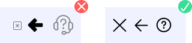
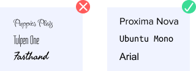
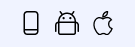
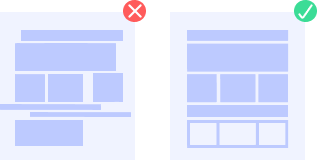
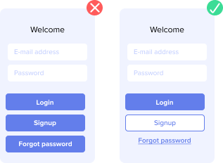
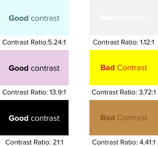
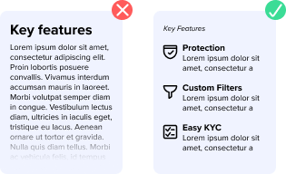

# Requirements

xApps are web apps, embedded in Xaman. They add value for users, using sign requests and their own interface to help users do things on the XRP Ledger and beyond. To build one, you need experience with frontend web development.


**This page covers the technical requirements for building an xApp.** For the full review process, including everything we require and expect, how to request a review, and what happens after approval, see [xApp publishing and review](https://help.xaman.app/app/learning-more-about-xaman/guidelines-and-review-process-of-publishing-xapps).


### Before you start

* Anyone can create a sandbox xApp. Only you and up to 10 testers can open it, added by their Device ID in the Xaman Developer Console.
* Having a sandbox xApp isn't an endorsement. Don't present it as one, for example on social media.
* Building a sandbox xApp doesn't guarantee that your xApp will be approved.

### Key requirements

These are the requirements developers most often miss. The [full list](https://help.xaman.app/app/learning-more-about-xaman/guidelines-and-review-process-of-publishing-xapps) is in the help center.

* You've completed KYC, and you're not anonymous.
* The source code of your xApp, and of its backend if it has one, is public on GitHub.
* Your xApp never asks for an account secret or private keys, in any form.
* Your xApp never asks users to sign SetRegularKey or SignerListSet transactions. There are no exceptions.
* No "Login with Xaman", "Connect Xaman" or "Disconnect Xaman" flows: use the user and account details from the xApp OTT.
* Every change to your xApp, however small, needs a new review before it goes live.

### Technical

* All links to external sites and window opens must use the `openBrowser` call in the Xaman SDK: Xaman UI interaction. This way, users can't reach another website by navigating inside the xApp.
* For reliable user-bound storage, use the Xaman SDK `userstore`, not cookies or localStorage: [https://github.com/XRPL-Labs/Developer-Help-Center/blob/main/js-ts-sdk/sdk-syntax/xumm.userstore](https://github.com/XRPL-Labs/Developer-Help-Center/blob/main/js-ts-sdk/sdk-syntax/xumm.userstore "mention")
* Don't use polling. To get the status of a payload, use the websocket we provide for status updates, or the `createAndSubscribe` or `subscribe` methods in the SDK: createAndSubscribe( … ) / \[subscribe( … )]\(TODO: link to the subscribe page). Backend applications can also use a webhook: Webhooks.

### Styling

* xApps should either have their own colour scheme (independent of dark/light mode) or respect the Xaman colour schemes: [Style guide](style-guide.md). The user's styling is passed to the xApp in the `xAppStyle` query parameter.
* The xApp `<html>` and `<body>` tags must have a `transparent` background colour right from page load, so the xApp doesn't flicker white while loading, until styling has been applied.

### Accessibility

* Simple accessible navigation
* Clear icons:\
  
* Reduce clutter: Keep minimum content on screen
* Use accessible fonts\
  
* Use minimal of 16pt font for standard **body text**
* Test on different devices:\
  
* Manage information on a logical level
* Consistency in design
* Use a 40x40px target area for touch controls
* Good (horizontal) alignment:\
  
* Distinction between primary and secondary Buttons:\
  
* Clear error text:\
  
* Appropriate color contrast:\
  
* No slang or bad grammar. Use proper English.
* Human like language:\
  
* Breaking up content:\
  

Accessibility Tools:

* Contrast checker link 1: [https://accessibleweb.com/color-contrast-checker](https://accessibleweb.com/color-contrast-checker/)
* Contrast checker link 2: [https://contrastchecker.com/](https://contrastchecker.com/)
* Iconset: [https://feathericons.com/](https://feathericons.com/)

### Sandboxed xApps

* Full access, no restrictions, but only for the developer and max. 10 testers (whitelisted by Device UUID in the Xaman Developer Console)

### Link (QR/Deeplink) only xApps

* The xApp should look appealing
* The xApp should respect different Xaman user screen sizes
* The xApp should be well crafted: it should be clear what the xApp will do, and it should do what the xApp promised to do
* The xApp should have a clear Support workflow & offer terms & conditions & a privacy statement

### Public (listed) xApps

* The xApp should not be a "launchpad" to something that could be perfectly located at a website: if there is no actual Xaman wallet/XRPL interaction where the integration with Xaman adds value, it should be a website, not an xApp
* Offer value (features people will appreciate/need) for a large part of the XRPL / Xaman user base
* The frontend source code must either be open source, shared (under NDA) with XRPL Labs for review or a third party security audit (code & dependencies + dependency update procedures) acceptable by XRPL Labs has to be provided.
